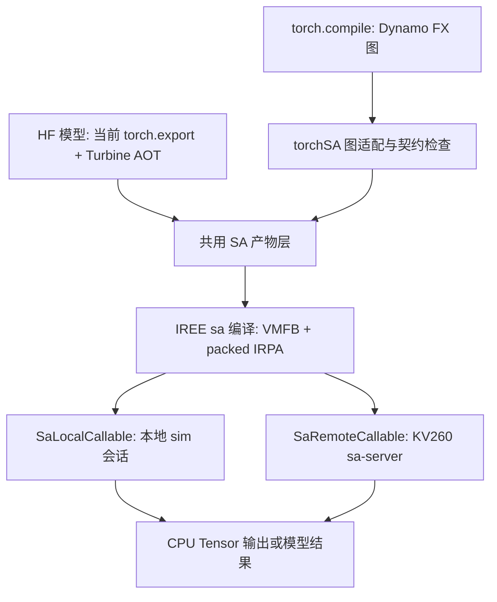

# torchSA v1 实现方案：将现有 SA 编译器接入 `torch.compile`

状态：实施方案，2026-10-23  
代码基线：[`Torch2RISCV-accelerator` main `f2b67a100962c7bc49100e2edddca23debadd7c9`](https://github.com/jonathansong/Torch2RISCV-accelerator/tree/f2b67a100962c7bc49100e2edddca23debadd7c9)  
目标硬件：KV260，现有 D16、100 MHz、四口 GEMV overlay  
目标范围：单设备、W8A8 推理、已有 SA 可编译的图；开发机上的 `sim` 先行，随后由同一个 backend callable 通过远程持久会话在 KV260 执行。完整 HF 模型继续复用现有多入口 AOT 导出。

## 1. 目标和验收口径

torchSA v1 为 PyTorch 提供一个可安装的 `torch.compile(..., backend="sa")` 后端。用户传入项目支持的量化 `nn.Module`，Dynamo 捕获图后，torchSA 编译到现有 IREE `sa` target，复用现有 `sa` HAL 执行，返回符合 PyTorch 调用约定的 CPU Tensor。无需修改或重编 PyTorch。

**v1 的完成标准分三级：**

1. **核心交付（必须）**：开发机上，至少一个无状态量化线性块和一个有状态的裁剪版 decoder block 通过 `torch.compile(backend="sa")` 在 `sim` 中执行；重复调用命中缓存；数值与现有 SA 导出路径一致。与现有 HF AOT 管线共用打包、编译和执行适配代码。
2. **KV260 callable（必须）**：同一个受支持的 FX 图通过 `torch.compile(backend="sa", fullgraph=True)` 生成 callable；开发机上的调用通过远程持久 `sa-server` 会话在 KV260 执行，返回 CPU Tensor。证明调用真实经过板端 SA dispatch，连续调用不重载权重或丢失会话状态，并报告网络传输、输出复制与设备执行时间。
3. **完整模型交付（必须）**：SmolLM2-135M 的 decode 和 prefill 继续通过现有多入口 AOT 导出，在 KV260 上运行；torchSA 的公共 API 能生成并加载相同格式的版本化产物，保持板上与 sim 的 logits 逐位一致。随后选择一个模型验证 `torch.compile` 的整块入口；若 Dynamo 图断裂、可变 KV 状态或模型占用无法满足条件，报告具体限制，不能把 AOT 成功标为 `torch.compile` 整模型成功。

示例接口（只有对应里程碑通过后才在 README 中承诺）：

```python
import torch
import torch_sa  # 注册名为 sa 的 Dynamo backend

qblock = torch_sa.load_supported_quantized_block(...)
run = torch.compile(qblock, backend="sa", fullgraph=True,
                    options={"target": "kv260", "address": "kv260.local:9090"})
out = run(x)
```

单独提供 `torch_sa.export_hf(...)`，把项目现有多入口 HF 模型导出做成稳定 API。它与 `torch.compile` 后端共享产物管理，但不声称 `torch.compile` 自动承担整个 HF 导出步骤。

### v1 明确边界

| v1 支持 | 后续阶段 |
|---|---|
| 前向推理，显式列出的模型、形状、dtype、量化格式 | 训练与反向传播，任意 PyTorch 模型 |
| CPU Tensor 作为 Python 调用边界；SA 内部常驻 buffer | `tensor.to("sa")`、`device="sa"` 原生设备 |
| 现有 SA HAL、VMFB、IRPA；本地 `sim` callable 和远程 KV260 callable | PrivateUse1 的 allocator、DeviceGuard、ATen eager 算子 |
| v1 自身不承诺遇到不支持算子仍保持加速 | 自动、无感的 PyTorch 算子级 CPU fallback |

PyTorch `torch.compile` 接口与原生设备接口是两个独立层次。`backend="sa"` 不会使普通 PyTorch Tensor 获得 SA device 身份；在 Python 调用边界，输入和输出仍是 CPU Tensor。模型内部的 CPU fallback 若被允许，必须计入耗时和拷贝量。

## 2. 现有资产和真正的缺口

| 层 | 当前实现 | v1 要补的接口 |
|---|---|---|
| 模型加载和量化 | [`hf_generic.py`](https://github.com/jonathansong/Torch2RISCV-accelerator/blob/f2b67a1/compiler/frontend/hf_generic.py) 处理 HF 模型、W8A8、KV scale、RoPE/Norm 等改写 | 稳定的量化模型加载配置；清楚区分已量化模块与原始 FP 模型 |
| AOT 捕获 | `hf_generic.export()` 用 `torch.export`、Turbine AOT，导出 `main`、`prefill`、`prefill_kv`，可选 `prefill_all`；KV cache 是 mutable globals | Dynamo 图入口及其与现有 AOT 图形态的兼容检查；多入口和状态模型仍复用当前导出器 |
| 编译 | [`compile_sa.sh`](https://github.com/jonathansong/Torch2RISCV-accelerator/blob/f2b67a1/compiler/scripts/compile_sa.sh) 输入 `qllama.mlir`、`qllama.irpa`，输出 `sa.vmfb`、`sa_packed.irpa` | 参数化编译 API、元数据 manifest、缓存、错误诊断；不要复制一套 IREE pass |
| 执行 | [`sa-llm-run`](https://github.com/jonathansong/Torch2RISCV-accelerator/blob/f2b67a1/compiler/runtime/tools/sa_llm_run.c) 装载 IREE VM、`sa` HAL、模型和参数，保持上下文及 KV 状态 | 可被 Python 或远端服务调用的持久会话 API；不能每次函数调用都启动进程并重载权重 |
| 硬件及验证 | `sim` / board transport、逐 dispatch oracle、板端逐位测试；[v2.3 实测](https://github.com/jonathansong/Torch2RISCV-accelerator/blob/f2b67a1/docs/results_v2.3.md) 包含四模型 | 新入口与既有产物、现有质量和性能基线交叉验证 |

截至基线提交，v2.3 四模型所有 dispatch 在加速器执行，板上 logits 对 sim 17/17 步逐位一致。torchSA v1 的任务是提供新入口并保持这些性质，不把原有测量当作新入口的测量。

**架构关键点：** 完整 HF 导出中的 KV mutation、外置权重、可变 T 和多入口并不是一个随手传入的 FX 子图自带的功能。不要让 Dynamo backend 直接调用 `hf_generic.export()`：后者需要完整模型、权重及 export 配置，而 backend 只收到 `GraphModule` 和示例输入。两条入口在“规范化图 / MLIR 产物”及之后汇合。

## 3. 目标架构和接口



建议在仓库根目录新增 `torch_sa/` 包：

```text
torch_sa/
  __init__.py           注册后端、公开 API
  backend.py            Dynamo backend、FX 子图检查、boxed 调用约定
  graph.py              FX→Turbine/MLIR 适配、shape/dtype/alias 记录
  export.py             包装现有 HF AOT 导出，不重写模型前端
  compiler.py           调用现有 iree-compile、打包参数、读取诊断
  artifact.py           manifest 和产物原子发布
  session.py            共用 ABI；SaLocalCallable / SaRemoteCallable；state reset
  cache.py              缓存索引、版本验证、并发去重
  diagnostics.py        图断裂、主机回退、内存与延迟报告
  tests/
```

最终可以做成独立 wheel；开发初期可留在现有仓库，不引入单独发布和版本体系。注册优先通过包入口 `torch_dynamo_backends`，允许 `torch.compile(..., backend="sa")`。后端的实际签名是 `backend(gm, example_inputs) -> callable`，返回函数必须遵循 FX 图的输入和输出契约。训练暂不做，第一版不要引入完整 backward 编译；若采用 `aot_autograd` 以获取 functionalized 图，需按其 boxed 约定处理参数，并明确拒绝梯度路径。

### 3.1 FX 子图准入与图适配

入口检查 `training=False`、`requires_grad=False`、设备为 CPU、输入树结构、支持的 dtype/rank、shape guard，以及 `gm.graph` 中的 op 白名单。v1 公共 API 要求 `fullgraph=True`，让 graph break 明确报错；暂不支持多个 FX 子图在 CPU eager 和本地或远程 SA 调用之间往返。多图模式只作为后续诊断实验，不属于 v1 支持范围。

无状态原型先支持 `QLinear` 对应的 `int8 GEMV/GEMM + scale + 可支持的尾部逐元素算子`，再扩到 `RMSNorm / RoPE / attention`。先用当前量化模型追踪产出的**实际 FX op 名称**建立白名单，避免预先假设所有常见 PyTorch op 都能落到 SAHL。图形态差异通过标准化、分解或专门的 FX pass 解决；每个 pass 有输入条件和失败信息。

参数有两类：① 模型权重和 scale，在导出时固定并写入 IRPA；② 每次运行变化的 token、位置和激活，按图 ABI 传递。需检查 Dynamo 是否把模型参数 lift 成输入；不能误把一次运行的权重指针当作永久常量。v1 将量化块的参数固定到 artifact；编译后若参数对象、版本计数或登记摘要变化，callable 必须失效并报错，不能静默继续使用旧 IRPA。自动重新编译留到后续版本。

### 3.2 有状态 decoder 契约

将模型会话作为独立对象：一个 session 装载一次 VMFB/IRPA，KV cache 在 IREE VM 中保持；提供 `decode(token, pos, valid)`、`prefill(tokens, positions, valid)`、`reset()`。`reset()` 优先重建仅承载 mutable globals 的 VM context，同时复用已打开的 VM instance、SA device、参数 provider 和只读参数映射；若 IREE 生命周期不允许安全复用，再实现显式清零。它不得重新读取或复制整份 IRPA。验收必须证明两个独立提示词没有串状态，且 reset 的耗时和内存峰值可解释。

沿用已有动态 T ABI（`valid[T]`、`--pad=D` 的长度选择）。对于固定最大上下文的 artifact，记录 `max_len`、阵列尺寸 D、attention 的 T 分块尺寸 Tb、prefill chunk M、KV layout、V packed、KV scale 方案。每次调用验证 `1 <= T <= max_len`、padding 后的长度、`pos` 与 cache 边界；在 T 刚好为 Tb 整数倍时覆盖循环次数和 DMA 终止条件。对滑窗注意力，记录窗口及实际 KV 读取上界。

`torch.compile` 对 Python 可变状态和 IREE mutable globals 的处理必须单独验证。若直接从 Dynamo 图无法稳定表达同一模型的 `main/prefill` 共用状态，v1 的完整模型 API 使用现有 `torch.export` 多入口；仅在一个 decoder block 明确完成 mutation/alias 语义验证后开放相应 Dynamo 路径。

## 4. 编译、缓存与 artifact

为现有 [`compile_sa.sh`](https://github.com/jonathansong/Torch2RISCV-accelerator/blob/f2b67a1/compiler/scripts/compile_sa.sh) 加一个稳定、可脚本调用的参数层；保留其已验证的导入/导出权重、通用化和 FFN/attention 融合选项。编译输出固定为：

```text
artifact/
  sa.vmfb
  sa_packed.irpa
  manifest.json
  optional: graph.mlir, compilation.log, coverage.json
```

`manifest.json` 至少包含：入口名与输入输出 ABI、dtype/shape 约束、模型和量化标识、原始权重摘要、packed 参数摘要、编译器与 PyTorch/Turbine/IREE 版本、IREE 补丁集标识、SA target 选项、overlay 标识及固件 ABI、max_len、prefill M、KV/V 布局、主机回退统计、生成时间。大模型权重按文件或内容摘要生成一次版本标识，不在每个 token 调用时重新哈希 GB 级文件。

缓存键分两部分：

- **图键**：标准化后的图语义、操作属性、shape guard、参数布局、固定常量与量化数据版本。
- **目标键**：SA 编译选项、编译器提交、IREE 补丁集、runtime/descriptor ABI、D、GEMV 端口数、overlay/firmware 兼容标识。

第一次实现进程内缓存加本地磁盘缓存即可；同一键的并发编译使用锁或 single-flight future；先在临时目录完整产出并验证，再原子发布。命中时检查 manifest 与文件完整性，避免加载一半的 VMFB 或把另一张 overlay 的 artifact 用到当前板子。

**错误规则**：导出失败、SA codegen 不支持、设备内存不足、ABI 不兼容分别给出图节点或 dispatch 名、形状/类型、相关选项和下一步；除开发模式的显式开关外不静默转到 CPU。现有 `SA_HOST_FALLBACK` 可保留作定位用，但每次 fallback 的数量、墙钟时间、数据边界和最终覆盖率必须写入报告。

## 5. 持久运行时和部署顺序

目前 [`sa-llm-run.c`](https://github.com/jonathansong/Torch2RISCV-accelerator/blob/f2b67a1/compiler/runtime/tools/sa_llm_run.c) 已经证明 IREE VM、多入口查找和常驻 KV 可以工作，但它是完整推理 CLI。将 VM context、参数加载、buffer view 创建和函数调用抽成小型 C 接口，供 CLI 和新绑定共同使用：

```c
sa_session_open(vmfb_path, irpa_path, transport, options, &session);
sa_session_invoke(session, entry_name, inputs, n_inputs, &outputs);
sa_session_reset(session);
sa_session_close(session);
```

此处是拟实现的 API，不是现有符号。其返回值需带明确错误码和错误字符串；会话持有 IREE instance/context、`sa` device、参数 provider 和模型 module。Python 侧可选 pybind11、CFFI 或轻量 ctypes；固定 ABI C 层能先由现有 CLI 做回归，之后才绑定 Python。输入/输出先同步复制 CPU Tensor；使用 `.detach().contiguous()` 与显式 dtype、shape 校验；输出复制完成后才释放 IREE buffer。避免以 NumPy 临时对象的裸指针跨异步提交使用。

**sim 路径**：开发机 Python 进程通过 `SaLocalCallable` 和 C 绑定调用现有 `sa` sim transport，作为真实 `torch.compile` 功能验收。

**KV260 路径**：v1 采用远程持久服务，不在 A53 上安装 Dynamo、Turbine 或 IREE compiler。板端 `sa-server` 使用同一个 C session API，装载开发机编译和部署的 artifact；开发机的 `SaRemoteCallable` 通过 TCP 完成 capability 查询、artifact 装载、session 创建、函数调用、reset 和 close。控制消息可使用版本化的小型 JSON 或定长结构，Tensor 数据使用带 dtype/shape/长度描述的原始二进制；每个响应携带 session id、状态码和错误字符串。artifact 一次部署、权重一次装载，调用只传运行时输入并取回输出。连接断开、超时和 server 重启必须使旧 session 明确失效，不能隐式在空 KV 状态下继续执行。

这一远程 callable 是“开发机上的 `torch.compile` 调用在 KV260 执行”，但不是“板上原生 PyTorch eager backend”。README 必须保持这一区别。`SaLocalCallable` 与 `SaRemoteCallable` 共用 manifest、输入输出 ABI、pytree 重建、shape/dtype 检查和 session 语义，仅 transport 不同。

### 5.1 内存和调用开销

四模型 v2.3 板端设备内存峰值分别为 156、270、690、1220 MB；Llama 距其记录的 1259 MB heap 上限余量很小。v1 的 Python 绑定不得额外复制整个 IRPA，也不得为每个 token 创建新的 IREE VM context。保持权重/参数映射和 KV 常驻，只传递小型输入，并计入主机输出拷贝、Python 封装和 SA 命令提交耗时。读取 logits 到 CPU 是明确同步点，不应把设备周期当成 API 端到端延迟。

## 6. 分阶段实施（每一阶段能独立验收）

| 阶段 | 具体改动 | 验收门槛 |
|---|---|---|
| P0：基线与图摸底 | 固定依赖版本；打印量化线性块和 decoder block 的 Dynamo FX 图、节点、形状、参数提升形式和 graph breaks；记录当前 sim / board 基线 | 一份可重放的 FX op 清单与无法导入的节点清单；证明至少 QLinear 可沿现有 Turbine importer 到达 SA 能匹配的 MLIR，否则停止 runtime 扩展、先解决 FX→MLIR；不修改模型数值 |
| P1：编译器原型 | 后端注册、受支持的无状态 FX 图到 Torch MLIR/IREE；复用 `sa` target；输出 artifact 和结构化错误 | 一个合成 W8A8 线性块在 sim 完整运行；`backend="sa"` 确实执行 SA dispatch，不能只是 `gm.forward` |
| P2：Python 会话与缓存 | 抽取 C session、绑定 `sim`，进程内/磁盘缓存、manifest、参数版本检查 | 连续调用不重载权重或重新编译；shape/权重/target 改变导致预期失效；重复调用无内存泄漏 |
| P3：decoder block | 扩展 FX pass 和 op 清单，导入 attention/KV；明确 mutable 状态和输入 ABI | 两次不同提示词在 reset 后结果相同；多个 token 逐 dispatch 与 oracle 比较；T=Tb、2Tb、Tb±1 边界一致 |
| P4：KV260 远程 callable | 实现板端 `sa-server`、版本化 RPC、artifact 部署和 `SaRemoteCallable`；复用 C session | `run = torch.compile(..., backend="sa", fullgraph=True)` 的同一个合成块在 KV260 执行；连续热调用不重载；返回值与 sim 一致；报告 RPC、复制和设备时间 |
| P5：HF AOT 共用层 | `torch_sa.export_hf` 包装现有导出，多入口共用 artifact/compiler/session；保留完整预处理和 IRPA 路径 | SmolLM2 的 decode/prefill 在 sim 与当前 AOT 基线逐位一致，通过远程 session 在板端与 sim 逐位一致 |
| P6：整块/整模型评估 | 测 Dynamo fullgraph 能否覆盖裁剪版 SmolLM2；记录图断裂、host fallback、编译耗时和额外开销 | 给出 `torch.compile` 真正覆盖的作用域；板端吞吐及内存；与 v2.3 同条件对照 |

P1–P3 先形成可在 sim 使用的真实 backend；P4 闭合 `torch.compile` callable 到 KV260 的执行链；P5 保证不会为了新接口重新实现已工作的 HF 模型前端。P6 若有未支持图，交付精确缺口，而不是通过 CPU 回退掩盖。

## 7. 测试矩阵与数值要求

| 项目 | 样本和检查 | 判据 |
|---|---|---|
| 接口与运行位置 | 查看 `backend="sa"` 的实际 FX 编译次数、SA dispatch 计数、CPU fallback 数 | 必须证明真实经过 SA；fallback 为 0 的样本单列 |
| 算子数值 | 合成 W8A8 线性层，含 `-128`、非 `max/127` scale、K 分块、不同尾部算子 | 量化整数和 scale 原样导入；设备数值与现有 oracle 对比 |
| 状态语义 | decode 连续调用、同一 session 的 prefill→decode、reset 后第二提示词 | KV 不跨会话泄漏，pre/postfill 按现有参考逐位一致 |
| 动态 T | `T=1, Tb-1, Tb, Tb+1, 2Tb, max_len`，以及最后一个不满 tile 的块 | 遍历次数、DMA 边界和最后一个有效 token 均正确；超界明确失败 |
| 板端正确性 | 现有 `board_llm.py` / `board_longctx.py` 与新 artifact 交叉运行 | 板上 logits 对 sim 逐位一致；token 序列一致；现有 PPL 未回归 |
| 远程 callable | 连接、capability/ABI 检查、一次部署、多次调用、reset、断线和 server 重启 | 证明输出来自 KV260 SA dispatch；热调用不重载参数；失效 session 明确报错；sim/board 输出一致 |
| 缓存 | 冷启动、同图热启动、shape guard 变化、权重/scale 变化、D/端口/overlay 变化 | 可解释的命中和失效；不加载不兼容 artifact |
| 性能 | 编译、首次装载、热调用、Python 主机时间、设备周期、输出拷贝、峰值内存 | 同板、同 prompt、同 T 对比 v2.3；报告包括首次与热启动 |

逐位比较的对象须分清：**同一量化模型的 torchSA 与现有 SA sim/board 路径**要求逐位一致；原始 fp32/bf16 HF 模型是质量参照，按 PPL、logits 相关性等指标报告，不能要求其与 W8A8 逐位相同。

## 8. 关键风险和处理

1. **FX/torch.export 图不一致**：同一个 `nn.Module` 经 Dynamo 和 `torch.export(...).run_decompositions()` 会有不同参数提升、形状和 mutation 形式。P0 先输出双图差异；先支持实际出现且能 SA lowering 的图，复杂状态继续走既有 AOT。
2. **`torch.compile` 的调用契约**：Dynamo 会重编不同图、产生 graph break；捕获的图可能以列表、元组返回，并带 alias/mutation 语义。P1 先限定纯推理、无 in-place 的无状态块，P3 单独验证状态；v1 要求 `fullgraph=True`，不以多图模式掩盖不支持区域。
3. **量化没有自动推导**：原始 HF `nn.Linear` 的 fp32 图不会自行变成项目支持的 W8A8、KV int8、权重布局。先使用 `hf_generic.load(... quant=True, attn=True ...)` 或等价受支持 checkpoint；在 API 中标明量化准备的输入。
4. **板端无法直接运行桌面 PyTorch 负载**：较大的 HF 模型加载需开发机内存；v1 编译放在开发机，板端由轻量 `sa-server` 加载产物。AArch64 PyTorch/Turbine、板端编译和原生 eager device 不列为 v1 完成标准。
5. **CPU fallback 隐藏性能退化**：现有 `sa_command_buffer.c` 可以执行 VMVX host variant，但这与 PyTorch 因 graph break 回到 eager CPU 是两层不同回退。分别记录数量和耗时，报告明确来源。
6. **版本兼容与内部 API**：PyTorch Dynamo/AOTAutograd 和 Turbine 的部分接口仍可能变化。固定可重建的依赖、CI 做 backend import/小图测试；优先复用公开的 custom backend 契约，内部接口集中封装。
7. **内存峰值**：Llama 的设备余量小；第一轮以合成块和 SmolLM2 为主，加载/编译/板端执行尽量分进程，IRPA 不做整份双拷贝。
8. **远程执行故障语义**：网络重连、server 重启或 artifact 被替换可能丢失 KV 状态。RPC 对 session 和 artifact 使用不可复用的代际标识；任何不确定状态都使调用失败，只有显式 `reset()` 或新建 session 才能继续。

## 9. 交付物

- `torch_sa` Python 包及安装配置，`backend="sa"` 注册；小图使用示例。
- 编译与运行的持久会话层，独立于演示 CLI；本地 sim callable、KV260 `sa-server` 和远程 callable；manifest、缓存、错误诊断。
- HF AOT 包装 API，保留 `main / prefill / prefill_kv / prefill_all`。
- 一个合成量化块、一个 decoder block 和 SmolLM2 的可复现实验；sim/board 日志与覆盖率、性能表。
- README 写明 PyTorch/Turbine/IREE/overlay 的已验收版本、支持的模型和量化格式、是否允许 CPU fallback。

## 10. 最小任务切片与起步顺序

按下面的先后顺序开工，第一周以是否得到正确的 FX/MLIR 入口为决策点：

1. 在现有依赖环境对合成 `QLinear` 和裁剪版 SmolLM2 block，使用一个只打印 FX 的 backend；保存 `gm.code`、`graph.print_tabular()`、输入元数据、graph break 日志，并确认权重是 `get_attr` 还是 lifted placeholder、输出是否携带 mutation/alias。
2. 使用 Turbine 当前 `FxImporter`/AOT 导出路径对同一无状态块生成 Torch MLIR；比较 `hf_generic.export()` 的 IR，确认是否含 `sa` codegen 匹配的 int8、scale 和权重加载形式。若 QLinear 不能沿现有 importer 到达该形态，P0 判为 no-go：先解决 FX→MLIR，不并行扩展 runtime。
3. 从 `sa-llm-run.c` 抽出持久 session，先由 C CLI 回归，再把 `sim` 绑定到 Python；一次装载、多次调用，记录完整墙钟与设备周期。
4. 为通过 P1 的图实现 backend callable；接入缓存和 manifest。遇到不匹配形状或 dtype 直接报错，不能默默交还 `gm.forward`。
5. 实现最小 `sa-server` 与 `SaRemoteCallable`，让同一个 backend callable 的同步调用在 KV260 完成；再依次扩到状态块、HF AOT 共用层及整模型评估。每完成一级才扩大 README 的支持范围。

## 11. 外部接口参考

- [PyTorch 自定义 `torch.compile` backend 契约](https://docs.pytorch.org/docs/stable/user_guide/torch_compiler/torch.compiler_custom_backends.html)：`GraphModule` 与示例输入，返回同签名 callable，支持入口点注册。
- [PyTorch PrivateUse1 设备接入](https://docs.pytorch.org/tutorials/advanced/privateuseone.html)：供未来 `.to("sa")` 阶段参考；v1 不依赖。
- [IREE Turbine PyTorch 指南](https://iree.dev/guides/ml-frameworks/pytorch/)：JIT 与 AOT、外部参数、多入口和全局状态。
- [Turbine 当前 Dynamo backend 实现](https://github.com/iree-org/iree-turbine/blob/main/iree/turbine/dynamo/backends/base.py)：参考 FX importer 和 callable 封装；现有入口的设备推断及 `Launchable` 不可直接当作 SA 运行时。
- [TorchTPU backend 实现](https://github.com/google-pytorch/torch_tpu/blob/main/src/torch_tpu/_internal/compile/_backend.py)：长期架构参考；其 PrivateUse1 eager 设备、XLA/PJRT 与分布式部分不进入 v1。

**实现决策**：v1 的第一个可审查结果是“`torch.compile` 的真实 FX 子图在 sim 通过 SA 编译与执行”；第二个是“同一个 backend callable 通过远程持久 session 在 KV260 执行”；随后才通过共用产物层连接板端已有完整模型结果。只有第二项完成，才能声称 `torch.compile(backend="sa")` 的调用在 KV260 上执行；完整 HF AOT 成功不能替代这一证据。
